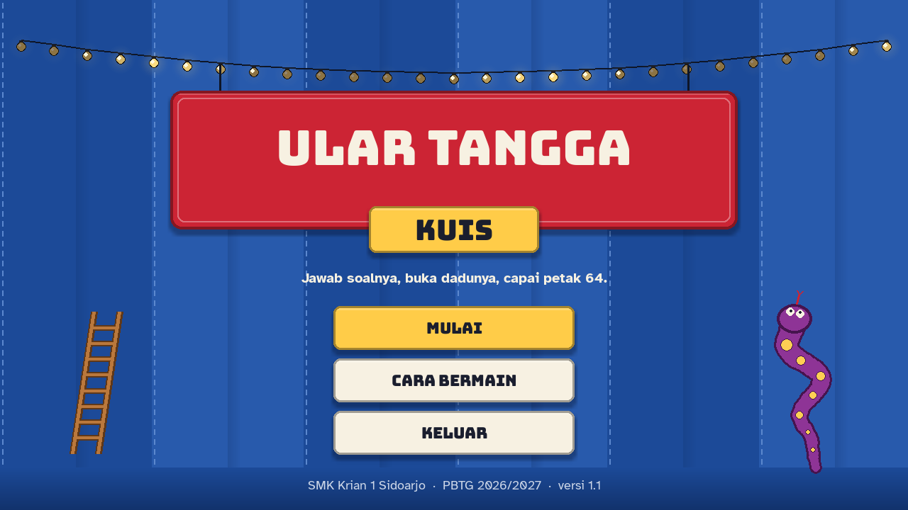
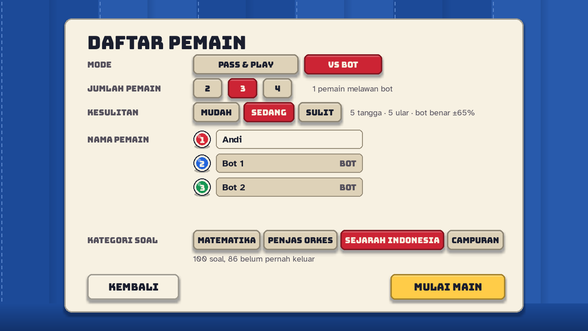
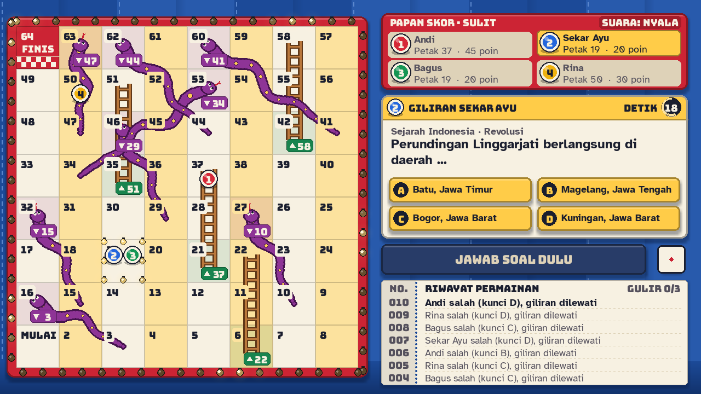
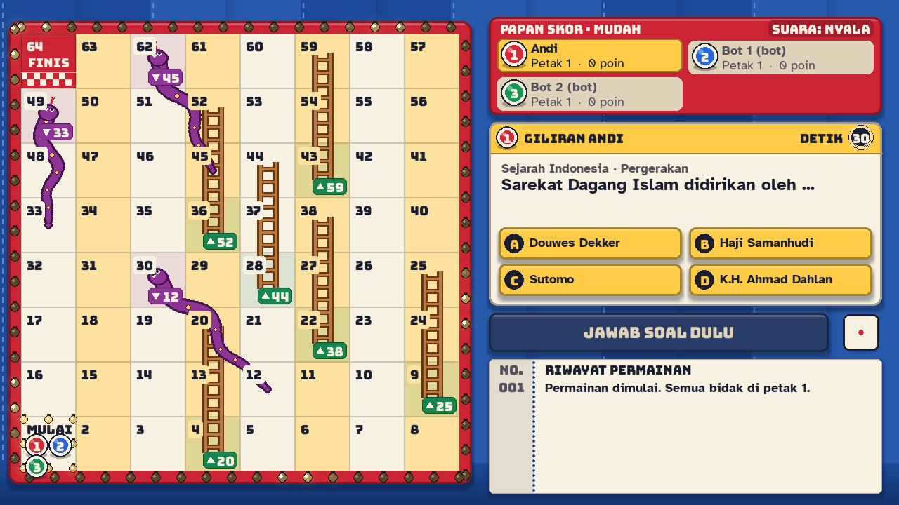
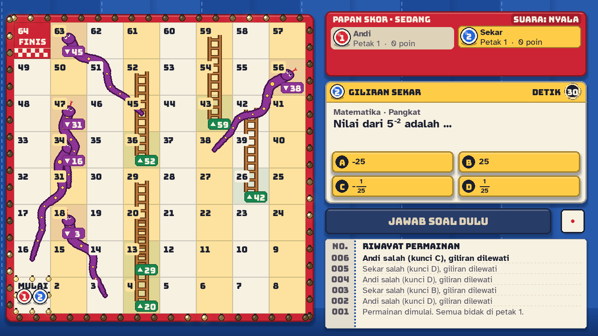
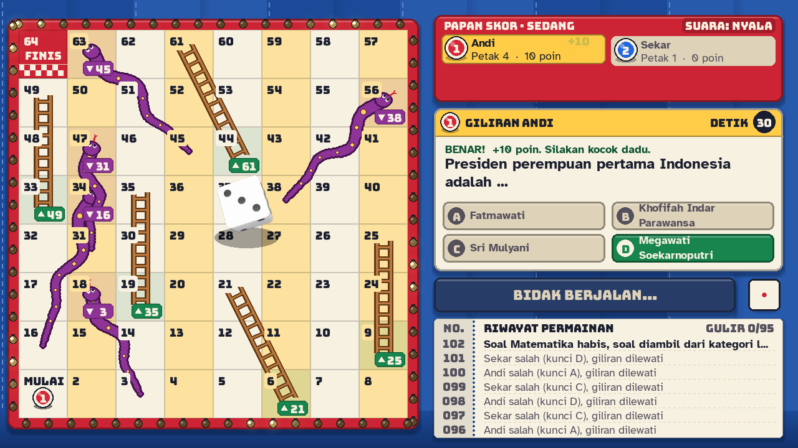
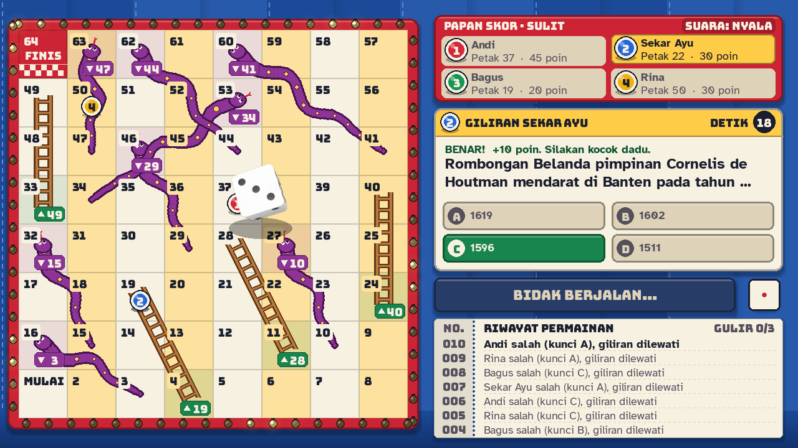
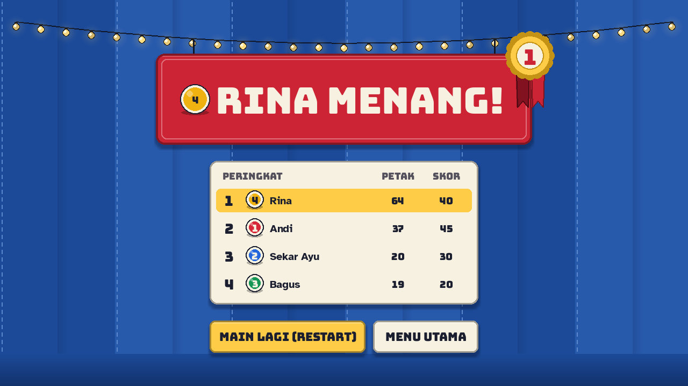
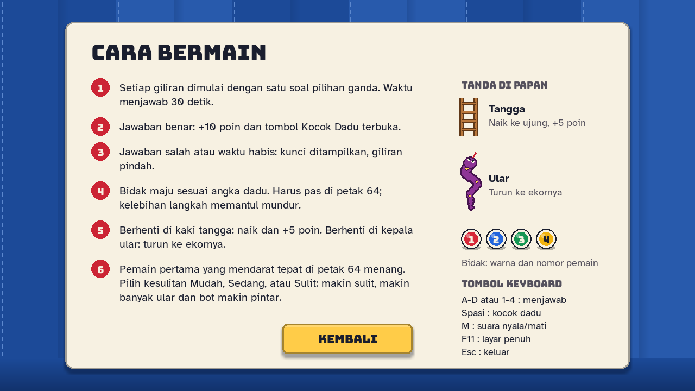

# Ular Tangga Kuis

<p align="center">
  <a href="docs/video/ular_tangga_kuis_promo.mp4">
    
  </a>
  <br>
  <a href="docs/video/ular_tangga_kuis_promo.mp4"><b>▶ Tonton video lengkap (dengan suara)</b></a>
  &nbsp;·&nbsp;
  <a href="https://github.com/FazaRizkyA/ular-tangga-kuis/releases/latest"><b>⬇ Unduh untuk Windows &amp; Android</b></a>
</p>

Game papan edukasi ular tangga berbasis kuis, 100% offline, dibuat dengan Python 3.12 + Pygame.
Project Sumatif Akhir Semester Ganjil, SMK Krian 1 Sidoarjo 2026/2027 (XI PBTG).

Setiap giliran dimulai dengan satu soal pilihan ganda (waktu 30 detik). Jawaban benar memberi +10 poin
dan membuka tombol **Kocok Dadu**; jawaban salah membuat giliran dilewati. Tangga: naik +5 poin.
Ular: turun. Pemain pertama yang mendarat **tepat** di petak 64 menang (kelebihan langkah memantul).

Papan 8 x 8 = 64 petak dengan tiga tingkat kesulitan:

| Kesulitan | Tangga | Ular | Bot menjawab benar |
| --- | --- | --- | --- |
| Mudah | 6 | 3 | sekitar 45% |
| Sedang | 5 | 5 | sekitar 65% |
| Sulit | 4 | 8 | sekitar 85% |

Soal yang sudah keluar tidak akan muncul lagi, termasuk saat **Main Lagi**. Bila soal kategori terpilih habis,
soal diambil dari kategori lain; baru setelah ke-300 soal keluar semua, bank soal diacak ulang.

## Tangkapan layar

| | |
| --- | --- |
|  |  |
| **Menu utama** | **Daftar pemain**: mode Pass & Play / vs Bot, 2-4 pemain, kesulitan, kategori |
|  |  |
| **Tingkat Sulit**: 8 ular, 4 tangga | **Tingkat Mudah**: 6 tangga, 3 ular |
|  |  |
| **Rumus ditulis bersusun**: pecahan, pangkat, akar | **Dadu 3D** hasil render Blender |
|  |  |
| **Jalur bidak menyala** petak demi petak | **Layar pemenang** + Main Lagi |

<details>
<summary>Layar Cara Bermain</summary>



</details>

## Anggota & peran

| Peran | Nama | Kontribusi |
| --- | --- | --- |
| Perancang Logika/OOP | (isi nama) | pemain.py, petak.py, papan.py, game.py |
| Desainer GUI & Aset | (isi nama) | main.py, tampilan.py, alat/buat_aset.py |
| Penyusun Bank Soal | (isi nama) | soal.json, soal.py |
| Packager/Tester | (isi nama) | installer.iss, build.bat, alat/uji_logika.py |

## Cara menjalankan (dari kode sumber)

```bat
python -m venv venv
venv\Scripts\pip install -r requirements.txt
venv\Scripts\python main.py
```

Kontrol: klik mouse, atau keyboard **A-D / 1-4** untuk menjawab, **Spasi** untuk kocok dadu,
**M** suara nyala/mati, **F11** atau **Alt+Enter** layar penuh, **Esc** keluar (dengan konfirmasi).

Rumus di `soal.json` memakai tanda sederhana yang digambar oleh `rumus.py`: `\frac{a}{b}` untuk pecahan,
`x^{2}` untuk pangkat, `√{48}` untuk akar, dan `∘` untuk komposisi fungsi.

## Cara build installer

Butuh Inno Setup 6. Dari folder `source_code` jalankan:

```bat
build.bat
```

Skrip ini menjalankan uji logika, lalu PyInstaller (`dist\UlarTanggaKuis\`), lalu Inno Setup.
Hasilnya: `..\installer\Setup_UlarTanggaKuis_v<VERSI>.exe`. Nomor versi cukup diubah di `config.py` (`VERSI`);
menu dan installer mengikuti otomatis.

## Riwayat versi

| Versi | Perubahan |
| --- | --- |
| 1.3 | Letak tangga ditata ulang: tidak ada lagi tangga yang menempel atau segaris (dulu tampak seperti satu tangga panjang) dan tangga tidak ditindih ular; diperiksa otomatis oleh `alat/cek_tata_letak.py`. APK rilis bertanda tangan v1+v2+v3 |
| 1.2 | Versi Android (APK) dari kode yang sama: layar penuh landscape, kendali sentuh, keyboard layar; build APK otomatis lewat GitHub Actions |
| 1.1 | Papan 8 x 8 (64 petak); tingkat kesulitan Mudah/Sedang/Sulit; 300 soal tanpa pengulangan; rumus Matematika ditulis bersusun (pecahan, pangkat, akar); dadu 3D hasil render Blender; tampilan digambar di resolusi layar sehingga tajam saat layar penuh (F11) |
| 1.0 | Rilis pertama: papan 6 x 6, 45 soal, mode Pass & Play dan vs Bot |

## Struktur

```text
ular-tangga-kuis/
├── main.py                  # titik masuk: class App, loop Pygame, 5 layar
├── game.py                  # GameManager: game state, giliran, skor, timer, log
├── pemain.py                # Pemain + turunannya Bot
├── petak.py                 # Petak + PetakTangga, PetakUlar, PetakFinish
├── papan.py                 # Papan 8x8, letak ular & tangga per kesulitan
├── soal.py                  # Soal + BankSoal (membaca soal.json, tanpa pengulangan)
├── dadu.py                  # Dadu (angka acak 1-6)
├── dadu3d.py                # animasi dadu 3D (render Blender / cadangan kode)
├── rumus.py                 # PenataRumus: pecahan, pangkat, akar bersusun
├── tampilan.py              # komponen gambar: papan cat, bohlam, tombol, karcis
├── kanvas.py                # lapisan gambar di resolusi asli layar
├── config.py                # konstanta, kesulitan, palet warna, VERSI
├── soal.json                # bank soal: 300 soal (100 per kategori)
├── icon.ico                 # ikon aplikasi Windows
├── requirements.txt         # pygame, pyinstaller, pillow
├── build.bat                # build .exe + installer Windows
├── installer.iss            # skrip Inno Setup
├── buildozer.spec           # konfigurasi APK Android
├── README.md · LICENSE · PRODUCT.md · DESIGN.md
├── assets/
│   ├── fonts/               # Bungee, Atkinson Hyperlegible (+ lisensi OFL)
│   ├── sounds/              # dadu, benar, salah, langkah, naik, turun, menang, klik
│   ├── dadu3d/              # dadu_1.png … dadu_6.png + info.json (gambar dadu 3D)
│   ├── icon.png
│   └── SUMBER_ASET.txt      # asal-usul setiap aset
├── aset_sumber/
│   └── dadu.glb             # model 3D dadu (bahan render Blender)
├── alat/                    # alat pengembang (tidak ikut installer)
│   ├── uji_logika.py        # 44 uji otomatis
│   ├── uji_simulasi.py      # 12 permainan penuh tanpa layar
│   ├── tangkap_layar.py     # tangkapan layar semua layar
│   ├── buat_aset.py         # ikon & efek suara
│   ├── render_dadu_blender.py
│   └── buat_sheet_dadu.py
├── docs/
│   ├── gambar/              # tangkapan layar untuk README
│   └── video/               # video promosi + pratinjau
├── .github/workflows/
│   └── android.yml          # build APK otomatis (GitHub Actions)
└── .impeccable/             # catatan desain (arah visual & token)
```

| File | Isi |
| --- | --- |
| `main.py` | Class `App`: loop Pygame, 5 layar (menu, cara bermain, setup, papan, pemenang) |
| `game.py` | Class `GameManager`: game state, giliran, skor, timer, log |
| `pemain.py` | Class `Pemain` dan turunannya `Bot` |
| `petak.py` | Class `Petak` dan turunannya `PetakTangga`, `PetakUlar`, `PetakFinish` |
| `papan.py` | Class `Papan`: 64 petak, letak tangga & ular sesuai kesulitan, gambar papan |
| `soal.py` | Class `Soal` dan `BankSoal` (membaca `soal.json`) |
| `dadu.py` | Class `Dadu` |
| `tampilan.py` | Komponen gambar: papan cat, bohlam, karcis, tombol, kolom teks |
| `rumus.py` | Class `PenataRumus`: menggambar rumus seperti tulisan (pecahan bersusun bergaris, pangkat di atas, akar bergaris atas) |
| `dadu3d.py` | Class `DaduRender`: animasi dadu 3D hasil render Blender dari `aset_sumber/dadu.glb`; class `Dadu3D`: dadu kubus buatan kode sebagai cadangan |
| `aset_sumber/` | Model `dadu.glb` (tidak ikut installer). Render ulang: `D:\Blender\...\blender.exe -b -P alat\render_dadu_blender.py`, lalu `python alat\buat_sheet_dadu.py` |
| `config.py` | Konstanta, palet warna, `resource_path()` |
| `soal.json` | 300 soal: 100 Matematika (aljabar dasar, eksponen, pangkat, akar, fungsi komposisi), 100 Penjas Orkes (renang, sepak bola, bulu tangkis), 100 Sejarah Indonesia |
| `icon.ico`, `assets/` | Ikon, font (.ttf), efek suara (.wav) |
| `alat/` | Alat pengembang: uji logika, pembuat aset, penangkap layar (tidak ikut installer) |

## Di mana prinsip OOP berada (untuk tanya-jawab)

Cari komentar penanda `# ENCAPSULATION`, `# INHERITANCE`, `# POLYMORPHISM` di kode.

- **Encapsulation**: `Pemain` (atribut `__skor`, `__posisi`; setter `skor` menolak nilai negatif;
  `pindah_ke()` menolak petak di luar 1-64), juga `Soal`, `BankSoal`, `Dadu`, `Papan`, `GameManager`.
- **Inheritance**: `Petak` → `PetakTangga`, `PetakUlar`, `PetakFinish`; `Pemain` → `Bot`
  (semua memanggil `super().__init__()`).
- **Polymorphism**: `GameManager.kocok_dadu()` cukup memanggil `petak.efek(pemain)`; tiap jenis
  petak punya efek sendiri. `Papan.gambar()` memanggil `petak.gambar()` dan `petak.gambar_label()`.
  `pemain.pilih_jawaban(soal)`: manusia mengembalikan `None` (menunggu klik), `Bot` memilih sendiri.

## Exception handling

`BankSoal.muat()` membungkus pembacaan `soal.json` dengan `try ... except FileNotFoundError`,
`except json.JSONDecodeError`, dan `except Exception`. Bila file hilang atau rusak, menu menampilkan
pesan dan tombol Mulai dinonaktifkan; program tidak crash. Soal yang formatnya salah dilewati.
Font dan suara yang gagal dimuat juga ditangani (font bawaan / tanpa suara). Kesalahan tak terduga
saat bermain ditangkap di loop utama dan aplikasi kembali ke Menu Utama dengan pesan.

## Pengujian

`venv\Scripts\python alat\uji_logika.py` menguji otomatis kasus T2, T4-T12, T14 dari PRD, aturan kesulitan, soal tidak berulang,
dan apakah semua soal muat di layar (44 pemeriksaan). `alat\uji_simulasi.py` memainkan 12 permainan penuh
tanpa layar di semua mode dan kesulitan. T1, T3, T13 diuji manual lewat aplikasi dan installer.

## Sumber aset

Lihat `assets/SUMBER_ASET.txt`.

## Unduh

Semua file ada di halaman **[Releases](https://github.com/FazaRizkyA/ular-tangga-kuis/releases/latest)**:

| Perangkat | File | Cara pasang |
| --- | --- | --- |
| Windows 10/11 | `Setup_UlarTanggaKuis_v1.3.exe` | Jalankan, ikuti petunjuk. Tidak butuh internet atau hak admin. |
| HP/tablet Android 7.0+ | `UlarTanggaKuis_v1.3.apk` | Lihat langkah di bawah. |

**Memasang di HP Android:**

1. Buka halaman Releases di HP, unduh file `.apk`.
2. Ketuk file yang sudah terunduh. Bila muncul peringatan, izinkan **Instal aplikasi tidak dikenal** untuk browser/File Manager.
3. Ketuk **Instal**, lalu **Buka**. Game berjalan mendatar (landscape) dan 100% offline.

Di HP: ketuk jawaban dan tombol dadu dengan jari, ketuk kolom nama untuk memunculkan keyboard,
tombol **Kembali** memunculkan konfirmasi keluar.

APK dibuat otomatis oleh GitHub Actions (`.github/workflows/android.yml`) memakai `buildozer.spec`.

## Lisensi

Kode program dirilis dengan lisensi [MIT](LICENSE). Font Bungee dan Atkinson Hyperlegible memakai
SIL Open Font License 1.1 (file lisensinya ada di `assets/fonts/`).
